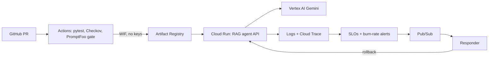

# SentinelRAG

**Production-grade GenAI service on GCP with SLO-driven auto-remediation.**

A RAG + tool-calling agent (Gemini on Vertex AI) wrapped in the platform a real team would need:
Terraform modules, keyless CI/CD, quality gates, observability, SLOs with burn-rate alerting, and
automatic rollback when the error budget burns too fast.

## Architecture



## Features

| Layer | What's here |
|---|---|
| Infra | Reusable Terraform modules (`infra/modules`) for Cloud Run, Workload Identity Federation, SLO monitoring |
| Security | Keyless GitHub → GCP auth (WIF), least-privilege service accounts, Secret Manager, Checkov policy scan |
| App | FastAPI RAG service: embeddings, vector retrieval, Gemini with tool calling, retries + model fallback |
| LLMOps | PromptFoo answer-quality gate in CI (incl. a hallucination guard) |
| Observability | OpenTelemetry → Cloud Trace; structured logs → log-based metrics for tokens and cost per request |
| SRE | Availability + latency SLOs, multi-window burn-rate alerts (5m AND 1h > 14.4) |
| Auto-remediation | Alert → Pub/Sub → responder that shifts traffic to the last healthy revision |
| Chaos | `scripts/chaos.sh` injects failures to prove the loop works end to end |

## Quickstart (local, free)

```bash
python -m venv .venv && source .venv/Scripts/activate   # Windows Git Bash
pip install -r requirements-dev.txt
cp .env.example .env            # LLM_MODE=fake needs no API key
pytest -q
uvicorn app.main:app --reload --port 8080 --env-file .env
```

Open http://localhost:8080/docs. Set `LLM_MODE=real` and `GEMINI_API_KEY` in `.env` to use Gemini.

## Deploy to GCP

1. Create a project, enable APIs, create a `<project>-tfstate` bucket.
2. `cp infra/envs/dev/terraform.tfvars.example infra/envs/dev/terraform.tfvars` and fill it in.
3. `terraform -chdir=infra/envs/dev init -backend-config="bucket=<project>-tfstate"` then `apply`.
4. Set GitHub repo variables `GCP_PROJECT_ID`, `GCP_REGION`, `WIF_PROVIDER`, `DEPLOY_SA` and secret `GEMINI_API_KEY`.
5. Merge to `main` → CI tests, scans, evaluates, then deploys.

## Reliability demo

<!-- Add screenshots to docs-assets/ and fill in your timeline -->
| Time | Event |
|---|---|
| T+0 | Bad revision deployed (`FAILURE_RATE=0.5`) |
| T+?m | Fast-burn alert fires |
| T+?m | Responder rolls traffic back to previous revision |
| T+?m | Error rate back to 0 |

## Design decisions

- **In-memory vector index** keeps the demo cheap and simple; swap for Vertex AI Vector Search at scale.
- **Multi-window burn rate** (Google SRE Workbook) pages fast on real incidents without flapping on blips.
- **Traffic shifting instead of redeploying** makes rollback take seconds and needs no build.
- **Terraform ignores image and traffic** so CI and the responder own those without drift fights.

## Cost

Scales to zero; roughly $1–3/month idle. `terraform destroy` when not demoing.

## Roadmap

GKE + Argo CD, Binary Authorization, OPA/Conftest, staging env, cross-region failover.
